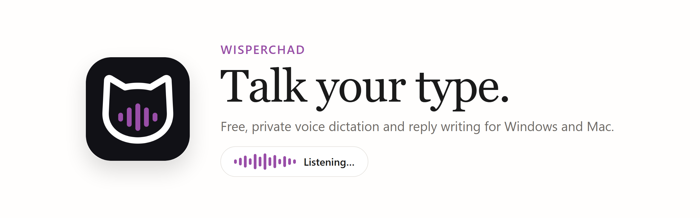
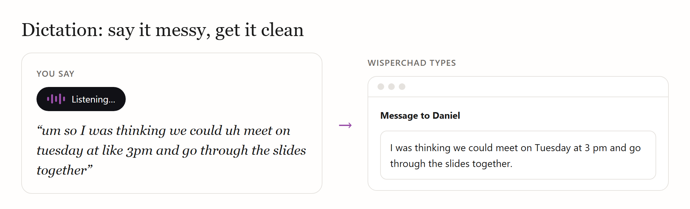
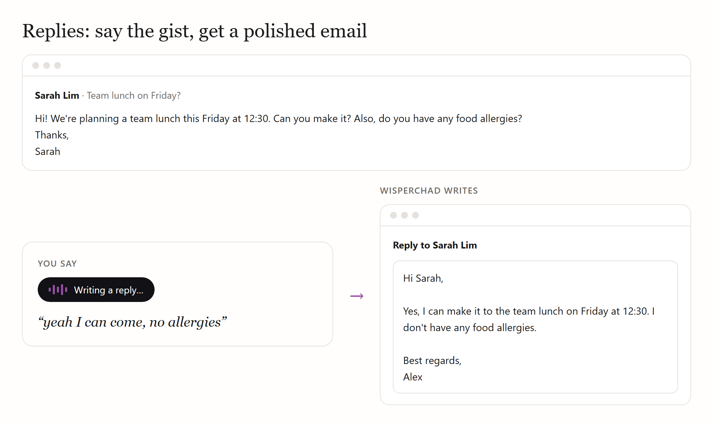
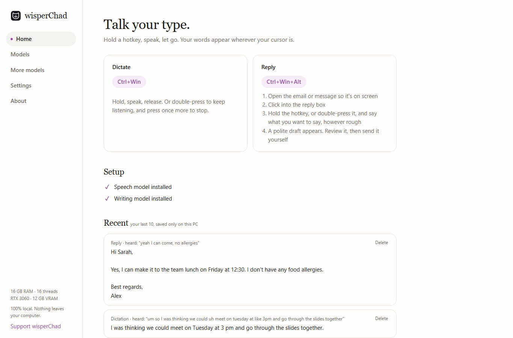

<picture>
  <source media="(prefers-color-scheme: dark)" srcset="docs/banner-dark.png">
  
</picture>

<p align="center">
  <a href="https://github.com/currymunchy/wisperchad/releases/latest/download/wisperChad-Setup.exe"></a>
  &nbsp;
  <a href="https://github.com/currymunchy/wisperchad/releases/latest/download/wisperChad.dmg"></a>
</p>

<p align="center">
  <a href="https://github.com/currymunchy/wisperchad/releases/latest"></a>
  <a href="LICENSE"></a>
  
  
  
</p>

<p align="center">
  <a href="https://currymunchy.github.io/wisperchad-app/"><b>Website</b></a> ·
  <a href="#download-and-install"><b>Install</b></a> ·
  <a href="#how-to-use-it"><b>How to use it</b></a> ·
  <a href="#faq"><b>FAQ</b></a> ·
  <a href="#support-wisperchad"><b>Support</b></a>
</p>

---

**wisperChad** is a free, open-source voice dictation app for Windows and Mac that runs entirely on your
own computer.

- **Hold a hotkey and talk.** Your words are transcribed, cleaned up and typed wherever your cursor is,
  in any app.
- **Hold the reply hotkey instead** and say the gist of your answer, however rough. wisperChad reads the
  message on your screen and writes a polished reply in the box, for you to check and send.

There's no account, no subscription and no cloud. The speech and writing AI models run on your computer,
so your voice and your messages never leave it.

## Contents

- [Highlights](#highlights)
- [See it in action](#see-it-in-action)
- [Why wisperChad](#why-wisperchad)
- [Download and install](#download-and-install)
- [How to use it](#how-to-use-it)
- [Choosing models](#choosing-models)
- [Privacy](#privacy)
- [How it works](#how-it-works)
- [Platform support](#platform-support)
- [FAQ](#faq)
- [Troubleshooting](#troubleshooting)
- [Build from source](#build-from-source)
- [Roadmap](#roadmap)
- [Contributing](#contributing)
- [Support wisperChad](#support-wisperchad)
- [Acknowledgements](#acknowledgements)
- [License](#license)

## Highlights

<table>
  <tr>
    <td width="33%" valign="top">
      <h3>Dictate anywhere</h3>
      Email, Word, Slack, WhatsApp, VS Code, your browser: if you can type there, you can talk there.
      Filler words like "um" and "uh" are taken out and punctuation is added for you.
    </td>
    <td width="33%" valign="top">
      <h3>Write your replies</h3>
      Say what you mean, like "yeah I can come, no allergies". wisperChad reads the message you're
      answering and writes a reply that fits it, as an email, a chat message or a comment.
    </td>
    <td width="33%" valign="top">
      <h3>Private by design</h3>
      Speech recognition and writing both run on your computer. Nothing you say or type is uploaded,
      and there are no accounts, analytics or ads.
    </td>
  </tr>
  <tr>
    <td width="33%" valign="top">
      <h3>Set up for your computer</h3>
      Setup checks your memory and graphics card, recommends models that fit, installs them and has
      you try everything once. Older computers get a dictation-only option.
    </td>
    <td width="33%" valign="top">
      <h3>You stay in control</h3>
      wisperChad drafts, you send. A reply is never sent for you, and your last 10 dictations stay on
      your computer with a Delete button each.
    </td>
    <td width="33%" valign="top">
      <h3>Free and open source</h3>
      MIT licensed, with no paid tier and nothing locked away. Built on whisper.cpp, llama.cpp,
      sherpa-onnx and Tauri.
    </td>
  </tr>
</table>

## See it in action

<picture>
  <source media="(prefers-color-scheme: dark)" srcset="docs/demo-dictation-dark.png">
  
</picture>

<picture>
  <source media="(prefers-color-scheme: dark)" srcset="docs/demo-reply-dark.png">
  
</picture>

<p align="center"><br>
<sub>The Home page, with your hotkeys and your most recent dictations and replies.</sub></p>

## Why wisperChad

Voice dictation apps are great, but most send your voice to the cloud and charge a monthly fee, and the
"write a reply for me" feature tends to sit behind a paid plan. wisperChad does all of it on your
computer, for free.

| | wisperChad | A typical cloud dictation app |
|---|---|---|
| Price | Free | A monthly subscription |
| Where your voice goes | Stays on your computer | Uploaded to the company's servers |
| Account | None | Required |
| Writing replies | Included | Often a paid extra |
| Works offline | Yes, once its models are downloaded | No |
| Source code | Open, under the MIT License | Closed |

## Download and install

### System requirements

| | Windows | Mac |
|---|---|---|
| System | Windows 10 or 11, 64-bit | macOS 13.3 Ventura or newer |
| Processor | Any 64-bit processor. Whisper models need AVX2, which nearly every PC since 2015 has | An Apple chip, M1 or newer |
| Memory | 4 GB for dictation, 8 GB or more for replies | 8 GB or more for replies |
| Disk space | About 1 GB for dictation, plus 2 to 4 GB for a writing model | The same |
| Graphics card | Optional. It makes replies much faster | Built in |

### Windows

1. **[Download wisperChad-Setup.exe](https://github.com/currymunchy/wisperchad/releases/latest/download/wisperChad-Setup.exe)**
   and open it.
2. If Windows SmartScreen warns about an unrecognised app, click **More info**, then **Run anyway**.
   wisperChad isn't code-signed yet, because signing costs money.
3. Setup checks your computer, recommends models that fit it, downloads them and has you try a dictation
   and a reply.

### Mac

1. **[Download wisperChad.dmg](https://github.com/currymunchy/wisperchad/releases/latest/download/wisperChad.dmg)**,
   open it and drag wisperChad into **Applications**.
2. wisperChad isn't notarized by Apple yet, because that takes a $99-a-year developer account, so macOS
   blocks it the first time. Try to open it, then go to *System Settings → Privacy & Security* and click
   **Open Anyway**. If macOS says the app is damaged, run this in Terminal and open it again:

   ```bash
   xattr -dr com.apple.quarantine /Applications/wisperChad.app
   ```

3. Setup asks for up to three permissions, each with an **Allow** button:
   - **Microphone**, to hear you.
   - **Accessibility**, to paste your text for you. Without it, your text is left on the clipboard.
   - **Screen Recording**, for replies that read the open window. Reopen wisperChad after allowing it.

### Linux

There's no Linux installer yet. wisperChad's code supports Linux and [builds from source](#build-from-source),
but nobody has tried it on a real Linux PC. Reports are very welcome.

## How to use it

### Dictate

1. Click where you want the text: an email, a document, a chat box.
2. Hold the dictation hotkey and speak. A small **Listening…** bar shows while it hears you.
3. Let go. Your words are cleaned up and typed at your cursor.

Prefer not to hold keys? Double-press the hotkey to keep listening hands-free, and press it once more to
finish.

### Reply

1. Open the email or message you're answering, and click into its reply box.
2. Hold the reply hotkey and say what you want to say, however rough: *"tell her thursday works but I'll
   be 10 minutes late"*.
3. Let go. A polite, ready-to-send reply is typed into the box. Read it, then press Send yourself.

wisperChad reads the message from the open window as you press the hotkey, through your computer's
accessibility features, including parts scrolled out of view, plus a screenshot for any pictures. Your
other tabs and windows aren't read, and neither are password fields. If you'd rather choose exactly what
it reads, set *Settings → Reply reads the message from* to **Text you copied**, then copy the message with
<kbd>Ctrl</kbd>+<kbd>C</kbd> first.

Replies take the right form for where you are: an email with a greeting and a sign-off in Gmail or
Outlook, just the message in WhatsApp, Teams or Slack, and a short comment on LinkedIn, Reddit or YouTube.

<details>
<summary><b>How wisperChad keeps your reply right</b></summary>

<br>

A reply takes two steps. First wisperChad finds the message you're replying to: the one just above the
box you clicked into, copied from the page's text, with the screenshot used for any pictures, charts or
tables. Then it turns what you said into your reply to that message.

Say it however it comes out, casual, unsure or angry, and it writes what a skilled professional in your
place would send, keeping your stance. How you feel tells it what you want, not how to sound: swear at a
recruiter and it's a polite, firm no; swear because something's great and it's warm. Swearing never
reaches the reply. A question you say is asked of them, not answered, and "tell him I can do noon" tells
him you can do noon. If you wrote last and they haven't answered, it writes your follow-up. Put your name
in Settings so it can tell your messages from theirs.

Then the draft is checked against what you said. Your own news told back to you as theirs, the time you
offered turned down, a no where you said yes, a link of theirs sent back to them, or a time, day or reason
of yours dropped or made up: any of these and the model is asked again, pointedly, up to twice.

The message is read while you're still talking, so once you let go only the writing is left.

</details>

### Hotkeys

| | Windows | Mac | Linux |
|---|---|---|---|
| Dictate | <kbd>Ctrl</kbd>+<kbd>Win</kbd> | <kbd>Ctrl</kbd>+<kbd>Option</kbd>+<kbd>D</kbd> | <kbd>Ctrl</kbd>+<kbd>Alt</kbd>+<kbd>Space</kbd> |
| Reply | <kbd>Ctrl</kbd>+<kbd>Win</kbd>+<kbd>Alt</kbd> | <kbd>Ctrl</kbd>+<kbd>Option</kbd>+<kbd>R</kbd> | <kbd>Ctrl</kbd>+<kbd>Alt</kbd>+<kbd>R</kbd> |

Change them in **Settings**: click the box and press the keys you want, like
<kbd>Ctrl</kbd>+<kbd>Shift</kbd>+<kbd>D</kbd> or just <kbd>F9</kbd>. You can also switch from **Hold to
talk** to **Press to start, press again to finish**. On Windows, adding <kbd>Alt</kbd> while you hold the
dictation keys turns it into a reply, so no words are lost.

### Dictate in another language

Speak in English and have it typed in another language: pick one under *Settings → Write dictation in*.
Translation uses the writing model, so check the result like any draft.

### Settings worth knowing

| Setting | What it does |
|---|---|
| **Microphone** | Use one other than your computer's default. |
| **Mute my speakers while recording** | On by default, so music or videos don't end up in your dictation. |
| **Launch on startup** | Start with your computer, with the window showing or hidden in the tray. |
| **Auto submit dictation** | Off by default. Presses Enter after a dictation, which sends it in most chat apps. Replies are never sent for you. |
| **Your name** | Lets replies tell your messages from theirs, and sign off as you. |
| **Background** | White, black, or match your computer. |
| **Keep writing model loaded for** | How long the writing model stays in memory after use. 5 minutes by default. |

The **About** page shows your version, where your app data and log files are, and the open-source
licenses. The log only records errors, never what you say or what's on your screen.

## Choosing models

You don't have to: setup recommends Light for almost every computer, and Transcription only for one with under 8 GB of memory.

| Preset | Recommended for | Listens with | Writes with |
|---|---|---|---|
| Transcription only | Under 8 GB of memory | Parakeet v2 | Nothing: it types what you say, with no clean-up and no replies |
| Light | Every computer with 8 GB of memory or more, graphics card or not | Parakeet v2 | Qwen3.5 2B |
| Balanced | Never picked for you. Choose it for a little more careful writing, with a graphics card with 6 GB of memory | Parakeet v2 | Qwen3.5 4B |

To choose for yourself later, the **Models** page offers two of each:

| | Model | Download | Pick it if |
|---|---|---|---|
| Speech | Parakeet TDT 0.6B v2 | 660 MB | You speak English. Fast on any computer, no graphics card needed |
| Speech | Whisper Small (English) | 470 MB | You'd like an alternative to Parakeet |
| Writing | Qwen3.5 2B | 2 GB | The one to start with: quick on any computer, and it reads screenshots, though it can misread a picture, so check the draft |
| Writing | Qwen3.5 4B | 3.4 GB | You have a graphics card with 6 GB of memory and want a little more careful writing, a little slower |

<details>
<summary><b>More models, memory use and Ollama</b></summary>

<br>

The **More models** tab lists every model with the memory it needs, its speed and how it should run on
your computer. Worth a look:

| | Model | Pick it if |
|---|---|---|
| Speech | Moonshine Base | You want the quickest and smallest. It stumbles if you talk very fast |
| Speech | Whisper Small Q5 | You want Whisper Small at under half the download |
| Writing | Gemma 4 E2B | You want quicker clean-up. It's slower at screenshots and can misread charts |
| Writing | Gemma 4 E4B | The same, with a larger model |
| Writing | Qwen3.5 9B | You have a powerful graphics card |

**Memory use.** The speech model stays loaded while the app runs (75 MB to 1.6 GB). The writing model
loads when you use it and unloads after the time set in Settings, so it doesn't hold your graphics memory
all day.

**Without a graphics card**, the writing model runs on your processor. Qwen3.5 4B then takes a few
seconds for clean-up and copied-text replies, and about a minute for a reply that reads the open window.

**Already use [Ollama](https://ollama.com)?** If it's running when you go through setup, wisperChad asks
whether to use it and lists the models already in it, so nothing downloads twice. Switch any time in
*Settings → Writing engine*. You can install any model from [ollama.com/library](https://ollama.com/library)
by typing its tag on the Models page, then click **Measure on my PC** to see what it really uses.

**Can't reach Hugging Face from your network?** Set the environment variable `WISPERCHAD_MODEL_MIRROR`
to any address that serves the same model files.

</details>

## Privacy

wisperChad was built so that nothing you say or type has to leave your computer.

- **Audio** is processed in memory and never leaves your computer or touches your disk.
- **Your last 10 dictations and replies** are saved on your computer so you can read them on Home. Older
  ones are dropped, and each has a Delete button.
- **Window text and screenshots** are only read when you press the reply hotkey. They go only to the
  writing model on your computer and are never saved.
- **Hotkeys made only of modifier keys**, like <kbd>Ctrl</kbd>+<kbd>Win</kbd>, work by checking which
  keys are down. wisperChad only looks for Ctrl, Alt, Shift and Win, and whether another key is down
  while one of those is held. It records nothing.
- **The internet** is only used to download the models you pick (from Hugging Face or Ollama) and the
  writing engine (from llama.cpp's GitHub releases, checked against a fixed fingerprint before it runs).
  The writing engine is only reached on your own computer, at `localhost`.
- **Feedback** is only sent when you write some on the About page and press Send. It carries what you
  wrote, your email if you added it, the app's version and your system, and goes by email through
  [Web3Forms](https://web3forms.com).
- **No accounts, no analytics, no ads, no telemetry.**

## How it works

```
 hold hotkey ──► microphone ──► speech model ──────► writing model ──────► typed at your cursor
                                Parakeet, Whisper     Qwen3.5, Gemma 4
                                or Moonshine          (optional: clean-up and replies)
                                                            ▲
                                       Reply: + the message you're answering, read from the window
```

| Part | Built with |
|---|---|
| App | [Tauri 2](https://tauri.app): a Rust backend with a plain HTML, CSS and JavaScript interface |
| Speech to text | [whisper.cpp](https://github.com/ggml-org/whisper.cpp) through [whisper-rs](https://github.com/tazz4843/whisper-rs), and NVIDIA Parakeet and Moonshine through [sherpa-onnx](https://github.com/k2-fsa/sherpa-onnx) |
| Writing | [llama.cpp](https://github.com/ggml-org/llama.cpp)'s server, on your graphics card when there's room and otherwise your processor, or [Ollama](https://ollama.com) |
| Typing | The text is put on the clipboard and pasted for you. It stays there, so you can paste it again |
| Reading replies | Windows UI Automation, or macOS Accessibility, plus a screenshot of the window |

Closing the window keeps wisperChad running in the system tray, so the hotkeys keep working. Quit it from
the tray icon.

## Platform support

| | Windows | Mac (Apple chip) | Linux with X11 | Linux with Wayland |
|---|---|---|---|---|
| Installer | Yes | Yes | Build from source | Build from source |
| Tried on real hardware | Yes | Yes | Not yet | Not yet |
| Hotkey of modifiers alone | <kbd>Ctrl</kbd>+<kbd>Win</kbd> | <kbd>Ctrl</kbd>+<kbd>Cmd</kbd> | <kbd>Ctrl</kbd>+<kbd>Super</kbd> | No |
| Text typed at your cursor | Yes | Yes, with Accessibility allowed | Yes | No, it's left on the clipboard |
| Writing on the graphics card | Vulkan | Metal | Vulkan | Vulkan |
| Reply reads the open window's text | Yes | Web pages and Mail | No, the screenshot alone | No, the screenshot alone |
| Mute speakers while recording | Yes | Yes, except a screen's own speakers over HDMI or DisplayPort | No | No |

<details>
<summary><b>Linux notes</b></summary>

<br>

- GNOME hides tray icons unless you add the AppIndicator extension. Without it, reopen the window by
  launching wisperChad again.
- **Wayland** is the default on most new Linux desktops. Run `echo $XDG_SESSION_TYPE` to see which one
  you're on. Wayland keeps apps from watching keys or typing into each other, so:
  - Hotkeys only work while an older (X11) app is in front. For a hotkey that works everywhere, add a
    shortcut in your desktop's keyboard settings that runs `wisperchad --dictate`, and another for
    `wisperchad --reply`. Each press starts listening, and the next one finishes.
  - Your text lands on the clipboard instead of at your cursor, and the listening bar reminds you to
    press <kbd>Ctrl</kbd>+<kbd>V</kbd>.
  - Set *Reply reads the message from* to **Text you copied**, because screenshots may fail.
- Choosing an X11 session on your login screen avoids all of this.

</details>

## FAQ

<details>
<summary><b>Is wisperChad really free?</b></summary>

<br>

Yes. There's no paid tier, no trial and no feature locked away. It's open source under the MIT License.
If it saves you time, you can [support it](#support-wisperchad), but you never have to.

</details>

<details>
<summary><b>Does it work offline?</b></summary>

<br>

Yes. Once setup has downloaded your models, dictation and replies work without an internet connection.

</details>

<details>
<summary><b>Which languages does it understand?</b></summary>

<br>

wisperChad listens in English for now. It can type your dictation in another language: pick one under
*Settings → Write dictation in*.

</details>

<details>
<summary><b>Will it ever send a message for me?</b></summary>

<br>

No. Replies are always left in the box for you to read and send. The only thing that ever presses Enter
for you is **Auto submit dictation**, which is off unless you turn it on, and never applies to replies.

</details>

<details>
<summary><b>Is my voice used to train AI?</b></summary>

<br>

No. Your voice, your messages and your replies never leave your computer, so there's nothing for anyone
to collect.

</details>

<details>
<summary><b>Why does Windows or macOS warn me when I open it?</b></summary>

<br>

Both warn about apps from developers who haven't paid for a code-signing certificate (Windows) or an
Apple developer account (Mac). wisperChad is open source, so anyone can read exactly what it does. The
steps under [Download and install](#download-and-install) get past the warning. A Microsoft Store version,
signed by Microsoft, is on the way.

</details>

<details>
<summary><b>How much memory and disk space does it need?</b></summary>

<br>

Dictation alone runs on most computers with 4 GB of memory and about 1 GB of disk. Replies work best with
8 GB of memory or more and 2 to 4 GB more disk for the writing model. A graphics card with 6 GB of memory
makes replies near instant. See [System requirements](#system-requirements).

</details>

<details>
<summary><b>How do I uninstall it?</b></summary>

<br>

- **Windows:** *Settings → Apps → Installed apps*, then **wisperChad → Uninstall**.
- **Mac:** quit wisperChad from its menu bar icon, then drag it from Applications to the Trash.

Your models and settings are kept in the app data folder shown on the About page. Delete that folder too
to remove everything. On a Mac it's `~/Library/Application Support/com.wisperchad.app`.

</details>

## Troubleshooting

<details>
<summary><b>The hotkey does nothing</b></summary>

<br>

- Check wisperChad is running: its icon should be in the system tray or menu bar.
- Another app may already use the same keys. Pick different ones in Settings.
- On Windows, hotkeys don't reach apps running as administrator while they're in front.

</details>

<details>
<summary><b>My text doesn't appear</b></summary>

<br>

The text is always put on the clipboard too, so press <kbd>Ctrl</kbd>+<kbd>V</kbd>
(<kbd>Cmd</kbd>+<kbd>V</kbd> on a Mac) to paste it. If you clicked away while it was being written, it
was typed where you clicked. On a Mac, check that wisperChad is allowed under *Privacy & Security →
Accessibility*.

</details>

<details>
<summary><b>Replies are slow</b></summary>

<br>

The first reply after a while loads the writing model, which takes a few seconds. Without a graphics card
the model runs on your processor, which is slower: try Qwen3.5 2B, or set *Reply reads the message from*
to **Text you copied**, which skips the screenshot.

</details>

<details>
<summary><b>A Mac permission stopped working after an update</b></summary>

<br>

Apps that aren't notarized can lose their permissions when they're updated. In *System Settings →
Privacy & Security*, remove wisperChad from **Microphone**, **Accessibility** and **Screen Recording**,
then add it again.

</details>

Still stuck? [Open an issue](https://github.com/currymunchy/wisperchad/issues) and say what you tried.

## Build from source

You'll need:

- [Rust](https://rustup.rs) (stable) and [Node.js](https://nodejs.org) 18 or newer
- [LLVM/Clang](https://releases.llvm.org) and [CMake](https://cmake.org), because whisper.cpp is compiled
  from source
- **Windows:** Visual Studio Build Tools with "Desktop development with C++"
- **Mac:** the Xcode Command Line Tools (`xcode-select --install`)
- **Linux**, on Ubuntu 24.04 or newer:

  ```bash
  sudo apt install build-essential clang cmake libclang-dev libwebkit2gtk-4.1-dev libgtk-3-dev libayatana-appindicator3-dev librsvg2-dev libasound2-dev libpipewire-0.3-dev libxcb1-dev libwayland-dev libegl-dev libgbm-dev libdrm-dev libdbus-1-dev
  ```

Then:

```bash
npm install
npm run dev                         # run it while you work on it
npm run build                       # build an installer, into src-tauri/target/release/bundle/
cd src-tauri && cargo test          # run the tests
```

On Windows, `npx tauri build --features vulkan` builds a version whose speech recognition runs on the
graphics card, with the [Vulkan SDK](https://vulkan.lunarg.com) installed.

**Tuning replies without a build.** The reply wording lives in `src-tauri/src/reply-prompts.json`. Copy
it to the app data folder and edit the copy: wisperChad reads it on every reply, and About says when it's
in use.

**Releases** are built by GitHub Actions. Pushing a tag like `v0.11.27` tests and builds the Windows
installer, the Microsoft Store package and the Mac app, and publishes them as the latest release.

<details>
<summary><b>Project layout</b></summary>

```
src-tauri/src/
  lib.rs          app setup, hotkeys, the record → transcribe → write → paste pipeline, UI commands
  chords.rs       hotkeys made only of modifier keys, like Ctrl+Win
  audio.rs        microphone capture and resampling to 16 kHz
  stt.rs          Whisper, Parakeet and Moonshine transcription
  engine.rs       the built-in writing engine (download, start, stop, chat)
  llm.rs          Ollama client (status, pull, delete, chat, memory measurement)
  prompts.rs      clean-up prompts, reply notes and output clean-up
  reply.rs        replies in two steps: find the message, then write the reply
  checks.rs       a reply's slips against what you said, each with what to ask the model to fix
  reply-prompts.json  the reply wording, which a copy in the app data folder can replace
  presets.rs      picks what to install for a computer
  presses.rs      tells a hold from a double-press
  speakers.rs     mutes the speakers while recording
  applog.rs       the error log
  catalog.rs      the model list with details and requirements (edit this to add models)
  hardware.rs     memory and graphics card detection for the requirements check
  input.rs        clipboard and paste
  screen.rs       screenshot of the active window for replies
  window_text.rs  text of the active window for replies
  settings.rs     settings stored as JSON
ui/
  index.html, app.js, styles.css   the main window
  splash.js                        the opening screen
  setup.js                         first-run setup and tests
  select.js                        dropdowns that stay inside the window
  about.js                         the About page
  theme.js                         black or white background, set before the page draws
  pill.html                        the floating "Listening…" bar
```

</details>

## Roadmap

- [ ] wisperChad on the Microsoft Store, signed by Microsoft
- [ ] Per-app tone: casual in Discord, professional in Outlook
- [ ] A custom dictionary for names and jargon
- [ ] Text that streams in while you talk
- [ ] Listening in more languages
- [ ] Installers for Intel Macs and Linux

Have an idea? [Open an issue](https://github.com/currymunchy/wisperchad/issues).

## Contributing

Issues and pull requests are welcome, and so are reports from trying wisperChad on a Linux PC or an Intel
Mac. See [CONTRIBUTING.md](CONTRIBUTING.md) for how to set up, test and send a change. A few principles
guide the project:

1. **Local first.** No feature sends audio or text to a server unless you set one up yourself.
2. **Never send a reply for the user.** wisperChad drafts, people press Send.
3. **Runs on modest hardware.** The defaults should work on an 8 GB laptop with no graphics card.
4. **No telemetry.**

## Support wisperChad

wisperChad is free and always will be. If it saves you time, you can help keep it going. Support pays for
code signing, so Windows and macOS stop warning people, and for testing on more computers.

<p>
  <a href="https://buymeacoffee.com/phuasien"></a>
  &nbsp;
  <a href="https://github.com/sponsors/currymunchy"></a>
</p>

Starring the repo and telling a friend helps too.

## Acknowledgements

wisperChad stands on the work of these projects and model makers:

- [whisper.cpp](https://github.com/ggml-org/whisper.cpp) and [llama.cpp](https://github.com/ggml-org/llama.cpp) by the ggml authors
- [sherpa-onnx](https://github.com/k2-fsa/sherpa-onnx) by the k2-fsa project, and [ONNX Runtime](https://onnxruntime.ai) by Microsoft
- [Tauri](https://tauri.app), and every Rust library listed under *About → Open-source licenses*
- Speech models: Whisper by OpenAI, Parakeet by NVIDIA and Moonshine by Moonshine AI
- Writing models: Qwen by the Qwen team at Alibaba Cloud, and Gemma by Google, with GGUF files by Unsloth
- [Ollama](https://ollama.com), for people who already use it

## License

Made by **Phua Si En**. wisperChad is released under the [MIT License](LICENSE).

The AI models are downloaded from their publishers and keep their own licenses, listed in the app under
*About → Open-source licenses*. wisperChad is an independent project and isn't affiliated with Wispr,
OpenAI, Ollama or any model provider.
